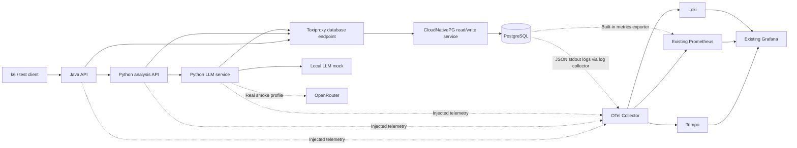

# Architecture

## Overview



Toxiproxy also fronts the Python→LLM HTTP path. Baseline and fault runs both use the proxies so comparisons stay consistent. Observability exporters and CloudNativePG monitoring bypass application fault paths.

## Components

### Applications (`otel-poc-apps`)

| Service | Runtime | Role |
|---------|---------|------|
| `java-api` | Java 21 / Spring Boot | Public `POST /api/recommendations` |
| `python-analysis` | Python 3.12 / FastAPI | `POST /analyze` — DB context + call LLM |
| `python-llm` | Python 3.12 / FastAPI | `POST /generate` — provider call + idempotent write |
| `llm-mock` | Python 3.12 / FastAPI | OpenAI-compatible `/v1/chat/completions` |
| `toxiproxy` | Toxiproxy | DB + LLM HTTP fault injection |
| `poc-postgres` | CloudNativePG Cluster | PostgreSQL 17, single instance |

### Platform

- **OpenTelemetry Operator** injects Java + Python agents via `Instrumentation` CRs
- **Central Collector** receives OTLP; exports traces→Tempo, metrics→Prometheus scrape, logs→Loki
- **Tempo / Loki** single-instance, ~24h retention, `local-path` PVCs
- **Existing Grafana / Prometheus** — POC-owned dashboards and ServiceMonitors/PodMonitors with `release: kube-prometheus-stack`
- **CloudNativePG Operator** owns generated DB resources; Argo CD owns the Cluster CR

### Expected trace shape

```text
Java HTTP server span
├── JDBC database span
└── HTTP client → Python server span
    ├── psycopg database span
    └── HTTP client → LLM service server span
        ├── GenAI operation
        │   └── HTTP client attempt(s) → mock/OpenRouter
        └── psycopg result-write span
```

PostgreSQL server logs do not carry application trace IDs. Client DB spans correlate traces; server logs diagnose the database. That distinction is intentional.

## GitOps deployment sequence

1. Namespaces, Argo CD project, secrets
2. cert-manager (reuse if present)
3. OTel + CloudNativePG operators
4. Tempo, Loki, Collector, DB log collector
5. Instrumentation CRs + CNPG Cluster
6. Seed Job, mock, Toxiproxy
7. Sample applications
8. Dashboards, monitors, test tooling

`./cli/poc bootstrap` requests Argo CD syncs in order and waits for health. Sync waves order resources *within* an Application; they do not order unrelated Applications.

## Fault and load surface

- **k6** — arrival-rate RPS, latency, thresholds
- **Toxiproxy** — latency, connection cut, timeouts on selected paths
- **Scoped pod deletes** — app or CNPG instance restart (Cluster CR + PVC retained)

Faults never run as Argo CD sync hooks. Each persistent fault starts with a deadline-based cleanup Job so state restores if the runner disconnects.
