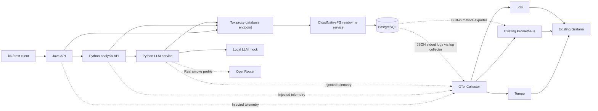

# OrbStack POC: Automatic Tracing, CloudNativePG, GitOps, and Chaos Testing

**Status:** Implementation plan only. No applications or infrastructure have been deployed or changed as part of this plan.

**Date:** 30 September 2026

## 1. Objective

Create a reproducible local POC that demonstrates:

- End-to-end tracing across Java, Python, an LLM service, and PostgreSQL client operations.
- Automatic instrumentation injected by the OpenTelemetry Operator, without OTel imports, tracing decorators, or SDK initialization in application source code.
- Argo CD-managed deployment of operators, applications, telemetry components, and configuration.
- PostgreSQL lifecycle management through CloudNativePG.
- Repeatable RPS, latency, retry, dependency-failure, and recovery tests.
- Correlated metrics, traces, and logs in Grafana.

The platform owns instrumentation packaging, injection, configuration, and compatibility testing. Application code contains business behavior and resilience logic, including retries where specified, but does not initialize the telemetry stack.

## 2. Agreed Decisions and Environment

### Environment observed during planning

- OrbStack Kubernetes: one healthy ARM64 node, Kubernetes `v1.35.6+orb1`.
- Container runtime reported by Kubernetes: Docker.
- Existing Argo CD: `v3.4.6`.
- Existing monitoring: Grafana, Prometheus, kube-state-metrics, and Prometheus Operator.
- Existing Grafana image: `12.0.0`.
- Default storage class: `local-path`.
- Node memory: approximately 8 GiB, with approximately 4.5 GiB in use when inspected.
- Other workloads already run in the cluster. Existing Kyverno image policies inspected during planning target other demo namespaces.
- A New Relic operator exists, but no New Relic instrumentation resources were present when inspected.
- This task's workspace contains no existing application implementation or Git repository.

These are planning-time observations. The implementation preflight must recheck them before making changes.

### Selected approach

- Increase OrbStack memory to **12 GiB**, after checking host capacity.
- Use a dedicated remote repository named **`otel-chaos-poc`**.
- Reuse existing Argo CD, Grafana, and Prometheus.
- Add **Tempo** for traces and **Loki** for logs.
- Deploy **CloudNativePG** for PostgreSQL.
- Use a local deterministic LLM mock for load and failure tests.
- Use **OpenRouter** for bounded real-model smoke tests with a user-supplied key and model ID.
- Use **k6**, **Toxiproxy**, and namespace-scoped pod-restart tests.
- Do not introduce Envoy, a service mesh, or a privileged chaos daemon in this POC.

### Why Tempo rather than Jaeger

Jaeger is a suitable tracing backend and provides service-performance views when connected to Prometheus. Tempo is selected because Grafana already exists and the POC requires navigation between metrics, traces, and logs. Deploy only one trace backend initially.

References: [Jaeger service-performance monitoring](https://www.jaegertracing.io/docs/2.4/spm/), [Grafana trace/log correlation](https://grafana.com/docs/grafana/latest/datasources/tempo/configure-tempo-data-source/configure-trace-to-logs/).

## 3. Architecture



Toxiproxy also provides a dedicated proxy for the Python-to-LLM-service HTTP connection. Keep selected connections routed through their proxies during both baseline and fault runs to make comparisons consistent. Observability exporters and CloudNativePG monitoring connect directly, outside the application fault paths.

## 4. Sample Applications and Interfaces

### Java API

- Runtime: Java 21 and Spring Boot.
- Public endpoint: `POST /api/recommendations`.
- Validate input, read a catalog item using JDBC, and call the Python analysis API.
- Return the recommendation and request identifier.
- Use standard application logging; no OTel initialization or tracing annotations.

### Python analysis API

- Runtime: Python 3.12, glibc-based image, and FastAPI.
- Internal endpoint: `POST /analyze`.
- Read additional context using psycopg.
- Prepare the LLM request and call the LLM service using HTTPX.
- Return the analysis result.

### Python LLM service

- Runtime: Python 3.12, glibc-based image, and FastAPI.
- Internal endpoint: `POST /generate`.
- Use the OpenAI-compatible Python SDK against either the mock or OpenRouter.
- Persist successful recommendations in PostgreSQL.
- Implement the bounded retry policy defined below independently of telemetry.

### Request and response contract

The public request contains:

- `request_id`: unique logical request identifier supplied by the test harness.
- `item_id`: identifies a seeded catalog item.
- `scenario`: an allowlisted POC behavior, defaulting to normal operation.

Responses contain the request identifier, result, and actual model name where applicable. Return consistent responses for invalid input, dependency unavailability, and timeouts.

Each service has separate liveness and readiness endpoints. Liveness is independent of downstream dependencies. Exclude health checks from tracing and traffic dashboards.

### Database behavior

- Seed synthetic catalog and context records.
- Store completed recommendations using a unique request identifier.
- Repeated requests must not create duplicate persisted results.
- Close database transactions before making LLM requests; do not hold database locks during inference.
- Do not automatically retry database writes.

### Mock LLM profile

Implement an OpenAI-compatible `/v1/chat/completions` endpoint with:

- Successful responses and fixed token-usage counts.
- Configurable response delay; default normal response delay of 50 ms.
- Two failures followed by success.
- Persistent HTTP 429 and HTTP 503 failures.
- Streaming responses for a separate streaming verification scenario.

Track retry state by request identifier so concurrent tests cannot interfere with each other's counters. Reset mock state between scenarios.

### OpenRouter profile

- Base URL: `https://openrouter.ai/api/v1`.
- API key supplied through a Kubernetes Secret.
- Explicit model ID supplied through deployment configuration.
- Same application image as the mock profile; only configuration changes.
- Five requests maximum, concurrency one, maximum 128 completion tokens per request.
- One attempt per request; no automatic retries.
- No load or chaos tests against OpenRouter.

Without a key or model ID, run the entire mock suite and clearly mark real-model verification as incomplete. Never silently substitute mock results for real inference.

Reference: [OpenRouter quickstart](https://openrouter.ai/docs/quickstart).

## 5. CloudNativePG Deployment

### Operator and database cluster

Deploy the CloudNativePG Operator through its official Helm chart using Argo CD. Deploy PostgreSQL as a `postgresql.cnpg.io/v1` `Cluster` resource named `poc-postgres`; do not create a separate hand-managed StatefulSet.

Defaults:

- PostgreSQL major version: **17**.
- Instances: **one** initially.
- Storage class: **`local-path`**.
- Data PVC: **2 GiB**.
- Application database: **`poc`**.
- Application credentials: Kubernetes Secret referenced by the database bootstrap and applications.
- Application database traffic: Toxiproxy upstream points to **`poc-postgres-rw`**.
- Database probes, replication/lifecycle management, and metrics bypass Toxiproxy.

The CloudNativePG 1.30 release line documents Kubernetes 1.35 compatibility. At implementation, pin a supported patch, matching chart, and ARM64 PostgreSQL image digest in the compatibility lock file. Validate the deployed combination on OrbStack rather than treating the compatibility matrix as an end-to-end deployment test.

Reference: [CloudNativePG supported releases](https://github.com/cloudnative-pg/cloudnative-pg/blob/release-1.30/docs/src/supported_releases.md).

### Database bootstrap

1. Wait for the CloudNativePG Operator, CRDs, and webhook to be ready.
2. Deploy the `poc-postgres` Cluster resource.
3. Wait for the primary and read/write service to become ready.
4. Run an idempotent schema and synthetic-data seed Job.
5. Deploy the sample applications only after initialization succeeds.

Use a distinct application account with database privileges appropriate to the sample workload. Application code must not use the PostgreSQL superuser account.

### Database monitoring

- Use CloudNativePG's built-in PostgreSQL metrics exporter.
- Create explicit Argo CD-managed `PodMonitor` resources for the database and operator.
- Select database pods using `cnpg.io/cluster: poc-postgres`.
- Recheck the existing Prometheus PodMonitor selector and namespace selector during implementation; apply the required release label.
- Provision the upstream CloudNativePG Grafana dashboard alongside the POC dashboards.
- Do not deploy a duplicate PostgreSQL metrics receiver or exporter.

Manage PodMonitors explicitly rather than depending on the deprecated automatic PodMonitor creation setting.

Reference: [CloudNativePG monitoring](https://github.com/cloudnative-pg/cloudnative-pg/blob/main/docs/src/monitoring.md).

### Database logs

- Configure slow-query logging at 250 ms for synthetic POC data.
- Collect CloudNativePG's structured PostgreSQL logs from container stdout.
- Use an OTel filelog collector on the OrbStack node with read-only log mounts and an include filter limited to the POC database pod logs.
- Parse the container log envelope and CloudNativePG JSON, enrich with Kubernetes metadata, and forward to the central Collector and Loki.
- Do not add the previously proposed database log-file sidecar or change CloudNativePG's log ownership.

PostgreSQL server logs do not automatically contain the application trace ID. Use client database spans for trace correlation and server logs for database diagnosis; make that distinction visible in the walkthrough.

Reference: [CloudNativePG logging](https://github.com/cloudnative-pg/cloudnative-pg/blob/release-1.30/docs/src/logging.md).

### Recovery boundary

One database instance demonstrates operator-driven restart recovery and persistence. It does **not** demonstrate replica promotion or database high availability. A future three-instance profile can test promotion and replication, but all instances on this single OrbStack node would still share a host failure risk. That extension is outside the initial acceptance criteria.

## 6. Automatic Instrumentation

Deploy the OpenTelemetry Operator through Argo CD. Create three named instrumentation profiles:

- `java`
- `python-web`
- `python-genai`

Add injection annotations to application pod templates through shared deployment templates. Limit pod-injection webhook selection to the POC application namespace and target only the Java/Python workloads.

### Java

- Use the pinned upstream Java auto-instrumentation image.
- Capture supported inbound HTTP, outbound HTTP, JDBC, runtime, and logging telemetry.
- Preserve ordinary JVM configuration.

### Python

Build custom injection images compatible with the applications' Python 3.12 and glibc environment:

- Web profile: FastAPI, HTTPX, psycopg, and supported logging instrumentation.
- GenAI profile: web profile plus `opentelemetry-instrumentation-genai-openai`.

Pin the SDK, exporters, instrumentation packages, and supported application dependency versions together. Validate injection-image layout, native dependencies, Python import paths, and startup behavior before rollout.

Application images retain normal startup commands. Do not activate additional agents through base-image launchers; injection must be the only activation mechanism.

References: [Operator injection](https://opentelemetry.io/docs/platforms/kubernetes/operator/automatic/), [Python GenAI instrumentation](https://github.com/open-telemetry/opentelemetry-python-genai/tree/main/instrumentation/opentelemetry-instrumentation-genai-openai).

### Trace propagation and identity

- Use W3C `traceparent` and `tracestate`.
- Use 100% sampling for the bounded POC.
- Configure service name, service version, namespace, and environment centrally.
- Have the test harness generate valid trace IDs and pass `traceparent` for deterministic trace lookup.
- Capture bounded scenario names as attributes; keep unique request/run identifiers out of metric labels.
- Verify concurrent requests remain separate traces.

Expected trace:

```text
Java HTTP server span
├── JDBC database span
└── HTTP client → Python server span
    ├── psycopg database span
    └── HTTP client → LLM service server span
        ├── GenAI operation
        │   └── HTTP client attempt(s) → mock/OpenRouter
        └── psycopg result-write span
```

CloudNativePG does not change this instrumentation boundary: database client operations appear in the trace, while PostgreSQL receives no Java/Python agent. OpenRouter appears as an outbound dependency; its provider's internal execution is not visible.

## 7. Collector, Storage, and Grafana

Deploy a central OTel Collector with:

- OTLP HTTP and gRPC receivers.
- Resource normalization, batching, memory limits, and bounded export queues.
- Trace export to Tempo.
- Metrics exposed for scraping by the existing Prometheus.
- Logs exported to Loki over OTLP.
- Span-derived request/error/duration metrics and service-graph metrics.

The existing Prometheus ServiceMonitor selector observed during planning requires:

```text
release: kube-prometheus-stack
```

Use single-instance Tempo and Loki deployments, approximately 24-hour retention, and 5 GiB PVCs each on `local-path`. Reuse existing Kubernetes resource metrics.

Enable supported Java/Python logging integrations so ordinary application logs include trace context. Keep prompts, completions, API keys, authorization headers, and SQL parameter values out of telemetry capture.

### Dashboards

1. **Service overview:** ingress RPS, errors, p50/p95/p99 latency, and dependency map.
2. **Runtime and database:** CPU, memory, restarts, JVM metrics, CloudNativePG status and PostgreSQL activity.
3. **LLM:** model identity, calls, duration, errors, and token usage when returned.
4. **Scenario comparison:** baseline, fault interval, and recovery.

Provision POC-owned dashboard and data-source ConfigMaps through existing Grafana sidecars. Verify metric exemplars where supported, trace-to-log links, and log-to-trace links.

Ingress RPS panels must count the Java API's server requests, not every client and downstream span. Reconcile counts with completed test runs after allowing exporter and scrape intervals to settle.

## 8. GitOps, Namespaces, and Resource Management

### Repository contents

- **Applications:** Java API, Python analysis API, LLM service, mock, and image builds.
- **Platform:** Argo CD applications, Helm values, instrumentation images/profiles, Collector configuration, CloudNativePG resources, schema bootstrap, dashboards, and monitors.
- **Tests:** k6 scripts, fault scenarios, retry assertions, cleanup, and evidence collection.

Record chart versions, upstream image digests, application dependencies, and the tested instrumentation combination in a compatibility lock file.

Build custom ARM64 images locally with unique immutable build tags. Use `IfNotPresent` and verify deployed image IDs against the build record. Rebuilding the images is part of reproducing the POC on a fresh OrbStack installation.

Reference: [OrbStack local image sharing](https://docs.orbstack.dev/kubernetes/).

### Namespaces

- `otel-poc-system`: OpenTelemetry Operator.
- `otel-poc-cnpg-system`: CloudNativePG Operator.
- `otel-poc-observability`: central Collector, database log collector, Tempo, and Loki.
- `otel-poc-apps`: sample services, CloudNativePG database, mock, and Toxiproxy.
- `otel-poc-tests`: test Jobs and run coordination.

Install cert-manager through a separately owned Argo CD application for the OTel Operator's webhook certificates. Recheck for an existing installation first and reuse it if one has appeared since planning.

### Deployment sequence

1. POC namespaces, Argo CD project, repository access, and required secret provisioning.
2. cert-manager and certificate readiness.
3. OpenTelemetry and CloudNativePG operators, CRDs, and webhooks.
4. Tempo, Loki, central Collector, and database log collector.
5. Instrumentation resources and CloudNativePG Cluster.
6. Database schema/seed Job, mock, and Toxiproxy.
7. Sample applications.
8. Dashboards, monitors, and test tooling.

A bootstrap command requests Argo CD syncs in sequence and waits for health at each stage. Use sync waves within applications; do not assume waves independently order unrelated Argo CD applications.

Ordinary resources reconcile automatically after bootstrap. Faults must never run as automatic sync hooks. Argo CD owns the CloudNativePG Cluster specification; CloudNativePG owns its generated database resources.

Reference: [Argo CD sync waves](https://argo-cd.readthedocs.io/en/stable/user-guide/sync-waves/).

### Operational defaults

- Two replicas each for the Java API, Python analysis API, and LLM service.
- One instance each of PostgreSQL, mock, Toxiproxy, Collector, Tempo, and Loki.
- Explicit CPU/memory requests and limits, with additional steady-state requests targeted below 4 GiB.
- Namespace quotas and one fault scenario at a time.
- Local-only interface access through OrbStack services or localhost port-forwarding.
- Kubernetes Secrets for credentials; no secret values committed to Git.
- Verify POC pods contain only the intended instrumentation and are not modified by another APM injector.
- Do not alter existing workloads, monitoring ownership, or unrelated admission policies.

## 9. Load and Failure-Test Behavior

### Tools

- **k6:** offered RPS, concurrency, latency measurements, thresholds, and summaries.
- **Toxiproxy:** latency, connection interruption, and timeouts on selected application paths.
- **Scoped Kubernetes operations:** application and database pod-restart scenarios.

Use arrival-rate executors for rate-controlled tests. Record achieved RPS and dropped iterations as well as requested RPS, so load-generator exhaustion is visible.

References: [k6 arrival-rate testing](https://grafana.com/docs/k6/latest/using-k6/scenarios/executors/constant-arrival-rate/), [Toxiproxy](https://github.com/Shopify/toxiproxy).

### Retry and timeout policy

For mock tests:

- Only the LLM service retries its provider call.
- Maximum three total attempts.
- Retry HTTP 429/503 and selected transient connection failures.
- Backoff: 100 ms, then 200 ms, with bounded jitter.
- Per-attempt timeout: two seconds.
- Disable built-in SDK retries to prevent multiplied attempts.
- Set upstream deadlines above the complete retry budget.
- Bound database connection/pool waits; do not retry database writes automatically.

For OpenRouter smoke tests, use one attempt with a 30-second provider timeout and longer upstream deadlines.

## 10. Scenarios and Acceptance Evidence

### 10.1 Baseline

- Warm up, then run 5 RPS for two minutes against the mock.
- Require at least 99% success, no dropped iterations, and initial p95 below one second.
- Retrieve a complete trace containing all three services and their database operations.

### 10.2 RPS spike

- Run 5 → 25 → 50 → 5 RPS, one minute per plateau.
- Record achieved throughput, dropped iterations, latency, errors, CPU, and memory.
- Within 60 seconds of returning to 5 RPS, require errors below 1% and p95 within 20% of baseline.

### 10.3 Downstream latency

- Inject 500 ms latency on the Python-to-LLM-service proxy for 60 seconds.
- Identify the affected client span and corresponding upstream duration increase.
- Remove the fault and confirm recovery.

### 10.4 Successful retry

- Mock returns 503 twice, then succeeds.
- Require exactly three outbound attempts under the same inbound request trace and an eventual HTTP 200.
- Distinguish failed internal attempts from final request success.

### 10.5 Retry exhaustion

- Mock continually returns 429 or 503.
- Require exactly three attempts, bounded completion time, and a controlled dependency-error response.
- Verify trace and dashboard error visibility.

### 10.6 Database connection outage

- Disable the application-facing PostgreSQL proxy for 30 seconds.
- Verify bounded database errors and continued application process liveness.
- CloudNativePG should remain healthy because only the application path is interrupted.
- Restore the proxy and confirm application recovery.

### 10.7 Slow database query

- Execute an allowlisted test query with a 500 ms PostgreSQL sleep.
- Require a slow database client span and a PostgreSQL slow-query log.
- Distinguish server query time from injected network latency.

### 10.8 Application pod restart

- Delete one selected Python application pod under steady load.
- Observe replacement, readiness, errors, and recovery.
- Record potentially incomplete traces from terminated requests rather than requiring zero trace loss during a crash.

### 10.9 CloudNativePG instance restart

- Delete only the POC database pod, retaining the Cluster resource and PVC.
- Observe CloudNativePG recovery, temporary errors, service readiness, and application reconnection.
- Verify seeded data and previously committed recommendations remain available.
- Label this as restart recovery, not failover.

### 10.10 Telemetry backend interruption

- Temporarily make Tempo unavailable.
- Confirm business requests continue and Collector retries/queues become visible.
- Restore Tempo and verify recovery within configured queue capacity.
- Record any dropped telemetry instead of assuming guaranteed delivery.

### 10.11 Real OpenRouter smoke

- Execute five requests at concurrency one with the configured token cap.
- Require a real provider response and connected application/outbound traces.
- Verify model and token-usage fields where returned; explicitly report missing telemetry.

### 10.12 Instrumentation comparison

- Redeploy the same application image IDs with injection disabled, then enabled.
- Compare CPU, memory, and latency over three short baseline runs per state.
- Confirm telemetry disappears and returns without changes to application source or image content.

### 10.13 Streaming verification

- Run a bounded mock streaming request.
- Verify completion, cancellation behavior, and available timing/usage telemetry.
- Do not treat time to first chunk as necessarily identical to time to first generated token.

### Fault cleanup

Create an independent deadline-based cleanup Job before activating each persistent fault. It must restore proxy or backend state even if the local runner disconnects. Cleanup must be idempotent.

Restrict mutation rights and target selection to POC namespaces and explicit resource names. Do not run node shutdowns, disk-filling tests, cluster-wide network partitions, or faults against existing workloads.

## 11. Implementation Phases

### Phase A — Compatibility and bootstrap

- Recheck cluster state, host capacity, policies, monitoring selectors, and existing operators.
- Increase OrbStack memory to 12 GiB.
- Establish the dedicated repository and Argo CD project.
- Pin compatible ARM64 components and instrumentation packages.
- Validate injection on minimal Java and Python pods.
- Validate GenAI instrumentation against the mock.
- Verify CloudNativePG bootstrap and metrics discovery.

### Phase B — Complete application trace

- Build the three services, mock, schema, and synthetic seed data.
- Deploy through Argo CD in the documented order.
- Retrieve a known trace ID and assert parent/child relationships, services, database spans, and outbound LLM calls.
- Test concurrent request separation and idempotent result persistence.

### Phase C — Metrics, logs, and dashboards

- Provision Collector pipelines, monitors, and Grafana dashboards/data sources.
- Reconcile request counts against test results after telemetry settles.
- Verify application log/trace navigation and CloudNativePG metrics and slow-query logs.
- Check captured telemetry for secrets and unwanted request/response content.

### Phase D — Chaos suite and real-model validation

- Run each scenario individually, then the repeatable mock suite.
- Run the OpenRouter smoke separately.
- Produce machine-readable results and a walkthrough of baseline, failure, diagnosis, and recovery.

## 12. Deliverables and Completion Criteria

Provide a documented command interface:

```text
poc doctor
poc build
poc bootstrap
poc smoke --mock
poc load --scenario spike
poc fault --scenario db-outage
poc fault --scenario db-restart
poc smoke --openrouter
poc verify
poc reset
poc destroy
```

Each run records:

- Run/scenario identifiers and start/end times.
- Git revision, component versions, and deployed image identities.
- Offered and achieved RPS, latency, errors, and dropped iterations.
- Trace IDs, relevant logs, and resource measurements.
- Fault activation, cleanup, recovery, and pass/fail assertions.

`poc reset` restores fault settings and mock state without deleting stored application data. Destructive database/PVC removal must be a separate explicit cleanup option; routine teardown must not accidentally prune the CloudNativePG Cluster or its data. Keep required database operators while retained clusters exist. Never remove shared Argo CD, Grafana, or Prometheus installations.

The POC is complete when:

1. A fresh deployment from the repository and documented local image builds reproduces the environment.
2. Argo CD reports the POC applications synchronized and healthy.
3. The sample application source contains no OTel initialization, custom spans, or telemetry decorators.
4. Full request traces connect Java, Python, the LLM service, and database client operations.
5. CloudNativePG metrics, logs, restart recovery, and persistence are verified.
6. The mock load/failure suite passes its documented assertions.
7. At least one successful bounded OpenRouter run is verified, with any provider/instrumentation gaps reported.
8. The same application images work with injection enabled or disabled.
9. Fault cleanup leaves the environment healthy and unrelated workloads unchanged.

### Required implementation inputs

- Remote repository URL and access for the dedicated `otel-chaos-poc` repository.
- OpenRouter API key supplied securely at deployment time.
- Explicit OpenRouter model ID.

### Boundaries

This is a single-node development POC. It does not establish production performance, host-level availability, replicated database failover, backup/restore readiness, or visibility into the internals of external LLM providers. Envoy, service meshes, privileged chaos frameworks, database replication experiments, and manual business-span instrumentation are outside the initial scope.
